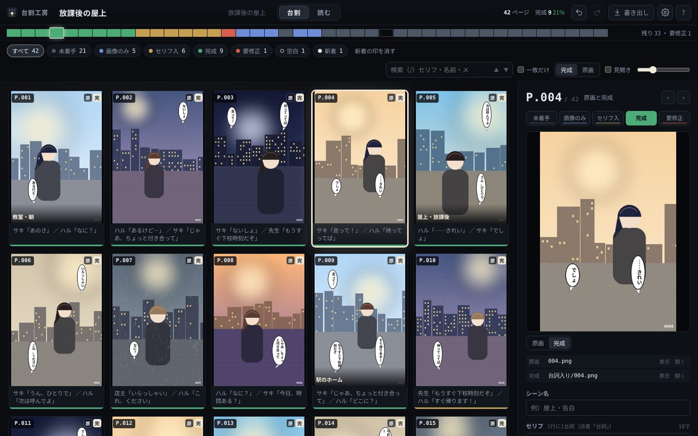

# 台割工房

生成画像で作るマンガの「台割」――ページの順番・進行・セリフ――を管理する、Windows 用の道具です。
画像フォルダの「台割.daiwari」をダブルクリックすると、専用のウィンドウ（Edge のアプリ窓）で開きます。



## 使う人へ

リポジトリの [`台割工房/`](台割工房) フォルダが、そのまま使える形です。

**おすすめ：git で取ってきて、更新は update.bat**

初回だけ、Git for Windows を入れて取ってきます（PowerShell で。置き場所にしたいフォルダで実行）。

```
winget install --id Git.Git -e
git clone https://github.com/ikemenngitarisuto-cpu/daiwari-kobo.git
```

1. `daiwari-kobo\台割工房\setup.bat` をダブルクリック（初回だけ。非公開なので clone のときにブラウザで GitHub へのサインインを求められます）
2. 画像フォルダを右クリック →「送る」→「台割工房」
3. 更新するときは `daiwari-kobo\台割工房\update.bat` をダブルクリック（GitHub Desktop の「Pull origin」でも同じ）

git を使わないときは [release/台割工房.zip](release/台割工房.zip) を落とし、プロパティで「許可する」にチェックしてから展開してください。
くわしくは「はじめにお読みください.txt」と [取扱説明書（PDF）](台割工房/取扱説明書.pdf) をどうぞ。

## いまの版：3.0.1（第1段）

いまの台割（v2）を丸ごと置き換える土台です。

| できること | 中身 |
|---|---|
| 1ファイル化と専用窓 | 本体は `台割工房.pyw` の1ファイル。閉じれば終わり、黒い窓は出ない |
| ダブルクリックで起動 | 各フォルダの `台割.daiwari`。「送る」とデスクトップへのドロップでも。古い `台割を開く.bat` も中継で動く |
| フォルダの常時監視と画素の指紋 | リネーム・メタデータ削除（番付工房）・上書き・台詞工房の保存（`台詞入り\`・`_V2`）を追う。似た絵は確認つき |
| 元に戻す・自動バックアップ | 200手まで（隔離のファイル移動も）。直近20回分＋日ごとの7日分 |
| 複数選択・3つの欄 | Shift／Ctrl で選んでまとめて操作。セリフ／メモ／修正指示 |
| 現行の機能 | 進行5段・並べ替え（ドラッグ／キー／番号指定）・空白と待ち受け・除外と隔離（`未使用`）・原寸で送る（1枚／見開き右綴じ／見比べ）・書き出し（連番コピー・台本・メタデータ削除） |
| v2 データの自動変換 | `.daiwari.json` → `台割.daiwari`。メモの振り分けと `_除外` のまとめは1回だけ聞く |

仕様の全体は「台割工房 再設計仕様」（Claude Docs）にあります。

## これから

- **第2段 台本**：台本の画面、話者と字数、台本の書き出し／取り込み、ドロップ取り込み、差し替えと旧版、区切り、縦スクロール表示
- **第3段 つなぐ**：台詞工房でそのページを直接開く、台割の順で連番リネーム、生成情報と ComfyUI、本棚、段取工房の取り込み

## 作り（開発メモ）

| 場所 | 中身 |
|---|---|
| `src/daiwari_kobo.py` | 本体（Python 標準ライブラリ＋Pillow）。HTTP は 127.0.0.1 だけ、起動ごとに合言葉 |
| `src/ui/` | 画面（HTML／CSS／JS）。`build.py` が本体へ埋め込んで1ファイルにする |
| `build.py` | そのまま使える `台割工房/` と `release/台割工房.zip`（UTF-8 の名前・bat は ASCII＋CRLF） |
| `台割工房/` | できあがり（`build.py` が作る。手で直さない） |
| `tools/` | アイコン・試験用フォルダ・画面写真・説明書の PDF を作る道具 |
| `tests/` | 中身の試験（pytest）と画面の試験（Playwright） |
| `docs/` | 説明書の元・画面写真・はじめにお読みください |

```
pip install pillow pytest playwright
python -m pytest tests                 # 中身と画面の試験
python build.py --manual               # 説明書の PDF も作り直して配布物を作る
DAIWARI_APP=台割工房/台割工房.pyw python -m pytest tests/test_e2e.py       # できあがりの1ファイルで画面の試験
```

試験に使う絵は、すべて `tools/make_sample.py` が機械で描いた架空のものです。
